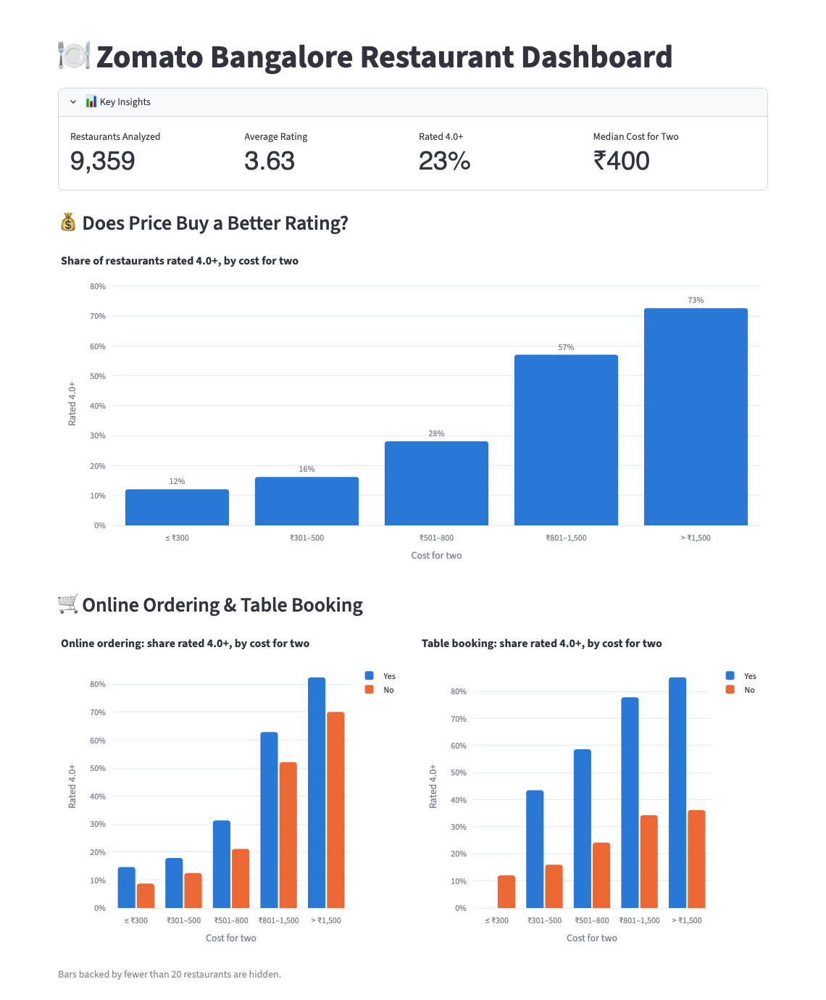
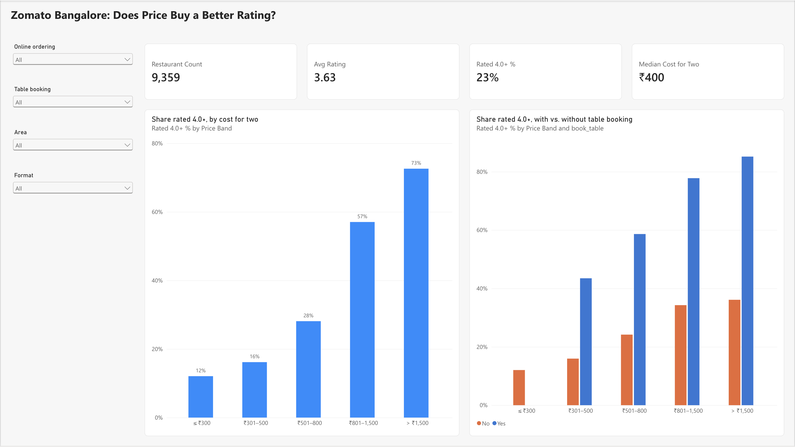

# 🍽 Zomato Bangalore Restaurant Dashboard

An interactive Streamlit dashboard that looks at what drives restaurant ratings across
**9,359 rated restaurants in Bangalore**. You can filter by area, format, rating, price,
online ordering and table booking, and every chart and KPI updates to match.

**Live app:** https://zomato-bangalore-dashboard.streamlit.app



## Key business insights

*"Top-rated" means a Zomato rating of 4.0 or higher. Across all restaurants, 23% are
top-rated.*

### 1. The budget end is crowded and under-delivering
Two-thirds of restaurants (67%) charge ₹500 or less for two, but only **14%** of them are
top-rated. Above ₹800 the share climbs steeply: **57%** at ₹801–1,500 and **73%** above
₹1,500. Quick Bites alone make up 39% of all restaurants, and only 11% of them are
top-rated.
**So what:** cheap food is a crowded market with weak quality. A consistently good budget
concept faces little top-rated competition. For a food platform, finding and promoting
good budget options is the clearest gap.

### 2. Table booking is the strongest single sign of a top-rated restaurant
Only 10% of restaurants take reservations, but **74%** of those are top-rated, compared
with **17%** of the rest. Price explains part of this: restaurants with booking have a
median cost of ₹1,200 for two, against ₹400 for the rest. But the gap holds within every
price band, for example **59% vs 24%** at ₹501–800 and **78% vs 34%** at ₹801–1,500.
**So what:** taking bookings marks a well-run, sit-down experience. For Zomato, extending
reservations to mid-priced restaurants is a growth lever. For a restaurant, booking comes
with higher ratings. This is a correlation, though, not proof that adding a booking
button raises a rating.

### 3. Online ordering comes with more than twice the engagement
61% of restaurants accept online orders. They collect a median of **72 votes**, against
**30** for restaurants that don't, which is 2.4× the engagement. They're also more likely
to be top-rated in every price band, for example 15% vs 9% at ₹300 or less.
**So what:** online ordering is now a basic requirement for being seen on the platform.
The 39% of restaurants without it are missing out on visibility.

### 4. The busiest areas have the weakest quality, which leaves room for proven brands
The five areas with the most restaurants are Whitefield, BTM, HSR, Marathahalli and
Electronic City. Together they hold 28% of the city's restaurants, but only **17%** of
those are top-rated, and Electronic City is lowest at 10%. Compare Indiranagar (**43%**
top-rated) and Koramangala 5th Block (**52%**). They also draw 4–5× the median votes:
139 and 172, against 34 in BTM.
**So what:** these high-supply IT-corridor suburbs have plenty of demand but few
top-rated options. That makes them the natural place for a strong brand to expand.

> **Caveats:** the data is a 2019 snapshot, from before the pandemic changed food
> delivery. Ratings and votes come from Zomato users. All findings are associations,
> not proof of cause.

## Data

- **Source:** [Zomato Bangalore Restaurants](https://www.kaggle.com/datasets/himanshupoddar/zomato-bangalore-restaurants)
  on Kaggle. The raw file has 51,717 listings (574 MB).
- **Cleaning** ([`scripts/prepare_data.py`](scripts/prepare_data.py)):
  - The raw file lists the same restaurant once for every browse category it appears in,
    so the script keeps one row per restaurant (name + address).
  - It parses ratings like `"4.1/5"` and costs like `"1,200"` into numbers.
  - It repairs broken text encoding in names, such as `Café` → `Café`.
  - It drops restaurants that aren't rated yet (`NEW`).
- **Result:** [`data/zomato_bangalore_clean.csv`](data/zomato_bangalore_clean.csv), with
  9,359 restaurants and 12 columns, 1.7 MB.

To rebuild the cleaned file, download `zomato.csv` from Kaggle and run:

```bash
python scripts/prepare_data.py path/to/zomato.csv
```

## Run locally

```bash
python3 -m venv .venv && source .venv/bin/activate
pip install -r requirements.txt
streamlit run zomato.py
```

## Power BI version

The same "Does price buy a better rating?" view, rebuilt in Power BI. Its numbers match
the Streamlit app exactly.



The [`powerbi/`](powerbi/) folder has everything needed to rebuild it: a Power Query
script that loads the data from this repo, the DAX measures, a matching theme, and build
steps for Power BI Desktop or the web, with numbers to check against.

## Project structure

```
├── zomato.py                      # Streamlit app
├── data/zomato_bangalore_clean.csv
├── scripts/prepare_data.py        # raw Kaggle export -> cleaned CSV
├── powerbi/                       # Power BI rebuild of one view
├── docs/dashboard.png             # README screenshot
└── requirements.txt
```

Built with Python, pandas, Plotly and Streamlit.
